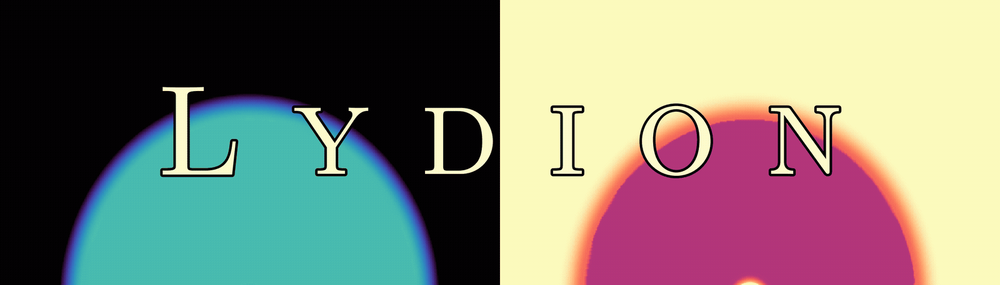

---
# Lyman-α Radiation Hydrodynamics & Stellar Feedback Simulations
**LYDION** (**LY**man-α **DI**ffus**ION**) is a fully coupled 2D Lyman-α (Lyα) radiation hydrodynamics (RHD) code, capable of simulating **Lyα radiation pressure feedback** on-the-fly. This is done using a novel M1 moment method for Lyα radiative transfer. Also implemented in LYDION is stellar and IR radiative transfer, detailed non-equilibrium ISM photo-chemistry and heating/cooling, and dust dynamics and dust physics.

Taken together, LYDION allows realistic simulations of stellar feedback around young massive stars and star clusters, from Lyα and non-Lyα radiation pressure, and photoionization. This can be used to assess the relative importance of these processes, and inform feedback prescriptions in 3D galaxy/star formation simulations.

This has become increasingly urgent recently, following the launch of the *James Webb Space Telescope* (*JWST*). With the *JWST*, observations of dust-poor galaxies at Cosmic Dawn has become possible, which is precisely the regime where Lyα feedback can strongly regulate star formation.

A full description and tests of LYDION can be found in the methodology paper: **TODO**

LYDION is primarily written in the Julia programming language ([Bezanson et al. 2017](https://doi.org/10.1137/141000671)), allowing for both fast development and good performance.

# Dependencies

Besides the core Julia language, the following external packages are used:

- HDF5.jl
- Interpolations.jl
- Roots.jl
- SpecialFunctions.jl
- StaticArrays.jl
- QuadGK.jl
- ProgressMeter.jl

These dependencies are listed in 'Project.toml', and can be installed automatically, as shown below.

# Installation

Clone the repository and activate the project environment:

```bash
git clone https://github.com/olofnebrin/LYDION.git
cd LYDION
julia --project=.
```

In the Julia REPL, all required dependencies can be installed using:

```julia
using Pkg
Pkg.instantiate()
```

# How to run an RHD simulation

The files **RunRHDSimulation_SingleStar.jl** and **RunRHDSimulation_StarCluster.jl**
contains the basic setup for running an RHD simulation of a single star or star cluster
embedded in a cloud, respectively, with or without Lyα feedback. In the star cluster setup, 
a Kroupa IMF-averaged (over 0.08 - 100 M⊙), spatially extended stellar source is used.
Cloud initial conditions, the mass of the star or star cluster, physics settings, 
resolution, and so on, can all be changed in those files. 
Running the relevant file will set up the simulation, start the simulation, 
and continuously save output data to an HDF5 file.

To launch, for example, a simulation of a single star from the repository root, 
using 8 CPU threads, do:

```bash
julia --project=. --threads=8 RunRHDSimulation_SingleStar.jl
```

Since checkpoint data and settings are saved, simulations can be restarted 
from the output in the HDF5 file. This can be done by specifying the 
right HDF5 file name in **RestartRHDSimulation_SingleStar.jl** (for the single star
setup), and then do (again assuming 8 CPU threads):

```bash
julia --project=. --threads=8 RestartRHDSimulation_SingleStar.jl
```

# Simulation output 

Simulation results in the HDF5 file can be used for post-simulation analysis. 
A variety of data is saved, e.g. the gas density and temperature, dust density,
chemical abundances, ecsape fractions, force diagnostics 
(see **SaveHDF5Data_RHD_SingleStar.jl** and **SaveHDF5Data_RHD_StarCluster.jl** 
for a full list). You can analyze this data however you want. Some simple 
Python code for making simulation animations and plots are included. 